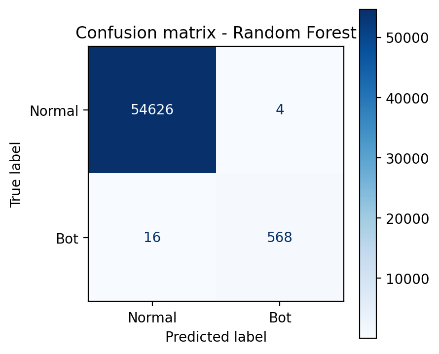
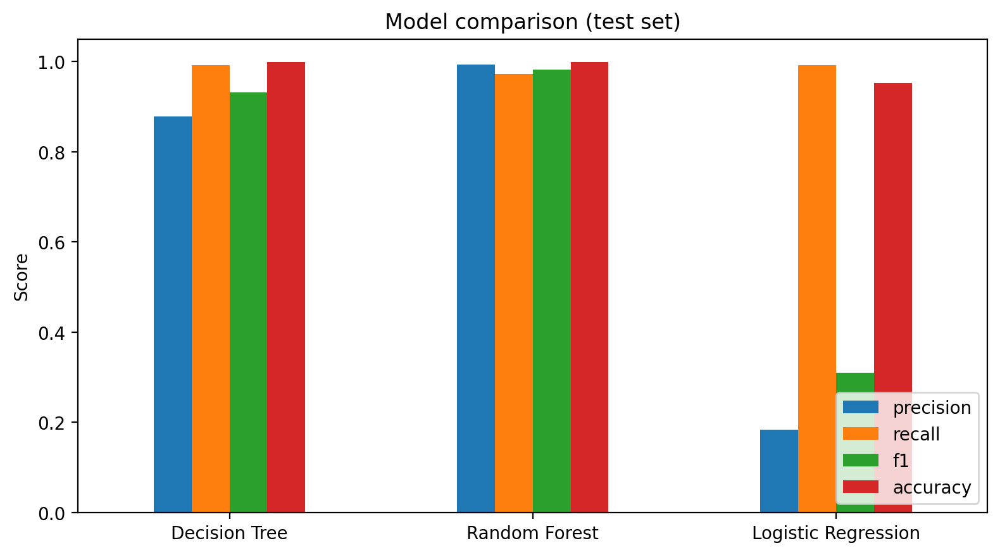
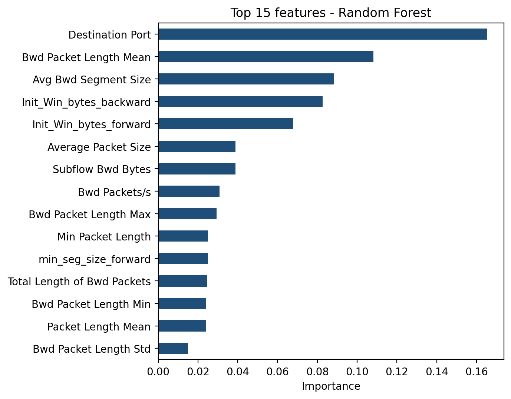
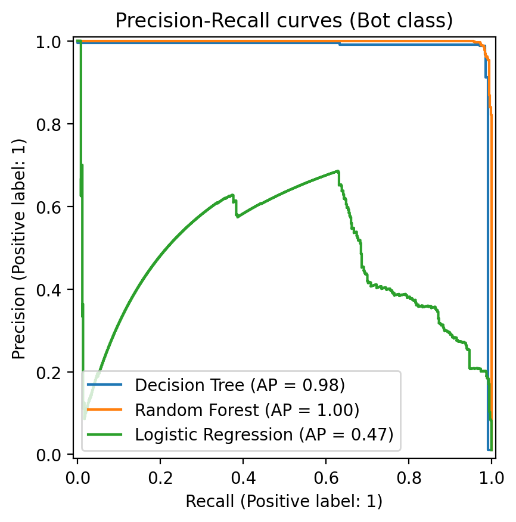

# AI-Based Botnet Traffic Detection

**Course:** Computer Networks | **Faculty:** Ms. Pragya Vats
**University:** Karnavati University, UnitedWorld Institute of Technology (UIT), Gandhinagar
**Author:** Vanshita Ramchandani (202407020218)
**Course code:**71305001009/73305001001  | **Group members:** Kanvika Diya(20240702094),Mitsu Patel(202407020130),Krishay Desai(202407020599)

A machine-learning prototype that classifies network flows as **Normal** or **Suspicious (botnet)** using flow-level features such as destination port, packet lengths and TCP window sizes, without reading packet payloads.

> This is a learning prototype. Its alerts need human review and further testing before any real-world use.

## Why botnet traffic?
A botnet is a group of compromised devices controlled by an attacker through a command-and-control (C&C) server. Bot traffic often shows regular, automated patterns and small control messages. Signature- and rule-based tools can miss new or modified botnets, so this project tests whether ML can learn these patterns from labelled flows.

## Dataset
**CIC-IDS2017** (Canadian Institute for Cybersecurity, University of New Brunswick): https://www.unb.ca/cic/datasets/ids-2017.html

This project uses the `Friday-WorkingHours-Morning.pcap_ISCX.csv` file from `MachineLearningCSV.zip`, which contains `BENIGN` (normal) and `Bot` (botnet) flows. The dataset is **not** stored in this repository because of its size: download it and place the CSV in `data/`.

| Cleaning step | Rows remaining |
|---|---|
| Loaded | 191,033 |
| After removing inf / NaN values | 190,911 |
| After removing duplicates | 184,044 (182,096 Normal, 1,948 Bot) |

Ten constant columns were dropped, leaving 67 numeric flow features. Bot flows are only about 1% of the data, so accuracy alone is misleading.

## Methodology
1. **Load** the CSV and strip column-name whitespace.
2. **Clean:** keep BENIGN and Bot rows, remove inf/NaN rows, remove duplicates (before splitting, to avoid leakage), drop constant columns.
3. **Split:** 70% train (128,830 flows) / 30% test (55,214 flows), stratified, `random_state=42`.
4. **Train:** Decision Tree (baseline), Random Forest (main model), Logistic Regression (linear baseline), all with `class_weight="balanced"`.
5. **Evaluate:** precision, recall, F1, false-positive rate, PR-AUC and confusion matrix on the unseen test set.

## Results
Measured on the held-out test set (584 Bot flows, 54,630 Normal flows):

| Model | Accuracy | Precision (Bot) | Recall (Bot) | F1 (Bot) | False alarms (FP) | Missed bots (FN) |
|---|---|---|---|---|---|---|
| Decision Tree | 0.9985 | 0.8786 | 0.9914 | 0.9316 | 80 | 5 |
| **Random Forest** | **0.9996** | **0.9930** | 0.9726 | **0.9827** | **4** | 16 |
| Logistic Regression | 0.9532 | 0.1833 | 0.9914 | 0.3095 | 2,579 | 5 |

The Random Forest detected 568 of 584 bot flows with only 4 false alarms. Logistic Regression shows why accuracy can mislead: 95% accuracy but only 18% precision.






The most important features are destination port, backward packet length statistics and the initial TCP window sizes. Feature importance shows what the model used, not why traffic is malicious, and some of these features may reflect the dataset's testbed rather than behaviour that generalises.

## Computer Networks concepts used
| Unit | Topics used in this project |
|---|---|
| Unit I | TCP/IP layers, HTTP and DNS: bots use application protocols for C&C |
| Unit II | Ports, TCP vs UDP, TCP window sizes and flags (direct model features) |
| Unit III | IP packets and flows; a router or gateway as a monitoring point |
| Unit IV | LAN traffic capture, packet sizes and packet analysis (indirect) |
| Unit V | Firewalls and intrusion detection; encrypted traffic motivates flow-based ML |

## Project structure
```
ai-botnet-traffic-detection/
├── README.md
├── LICENSE
├── requirements.txt
├── data/                    # put the CIC-IDS2017 CSV here (not tracked by git)
├── notebooks/
│   └── botnet_detection.ipynb   # step-by-step walkthrough
├── src/
│   ├── botnet_detection.py      # pipeline: load, clean, split, train, evaluate, plot
│   └── train.py                 # run the whole pipeline from the command line
├── app/
│   └── app.py                   # Streamlit demo
├── results/                 # metrics, charts, run_config.json
└── models/                  # created by train.py (model file is not tracked by git)
```

## Setup and run
```bash
git clone https://github.com/Vanshita655/ai-botnet-traffic-detection.git
cd ai-botnet-traffic-detection
python -m venv .venv
.venv\Scripts\activate           # Mac/Linux: source .venv/bin/activate
pip install -r requirements.txt
```
Place `Friday-WorkingHours-Morning.pcap_ISCX.csv` in `data/`, then:
```bash
python src/train.py --data data/Friday-WorkingHours-Morning.pcap_ISCX.csv
streamlit run app/app.py         # demo (run training first)
```
Or open `notebooks/botnet_detection.ipynb` in Jupyter.

## Reproducibility
Each run writes `results/run_config.json` with the dataset file, cleaning counts, split settings, model settings and library versions.

## Limitations
- One day of traffic and one botnet family from a single testbed dataset, so results may not generalise to other botnets or real networks.
- A random split of one capture can make results look better than on completely new traffic.
- Researchers have reported labelling errors in CIC-IDS2017.
- Flow features alone may miss slow or disguised botnet communication; false alarms and missed bots still occur.

## Ethics
Only a public, documented dataset is used. Any captured network traffic used in future work must be authorised and kept private.

## Future scope
Compare more models, test on other datasets such as CTU-13 with time-based splits, add explainability (e.g. SHAP) and evaluate false-positive rates on realistic traffic.

## References
- Canadian Institute for Cybersecurity, CIC-IDS2017 dataset.
- Sharafaldin, Habibi Lashkari, Ghorbani, "Toward Generating a New Intrusion Detection Dataset and Intrusion Traffic Characterization", ICISSP 2018.
- Scikit-learn User Guide: Random Forests and model evaluation.
- Wireshark User's Guide.

## License
MIT License. See [LICENSE](LICENSE).
